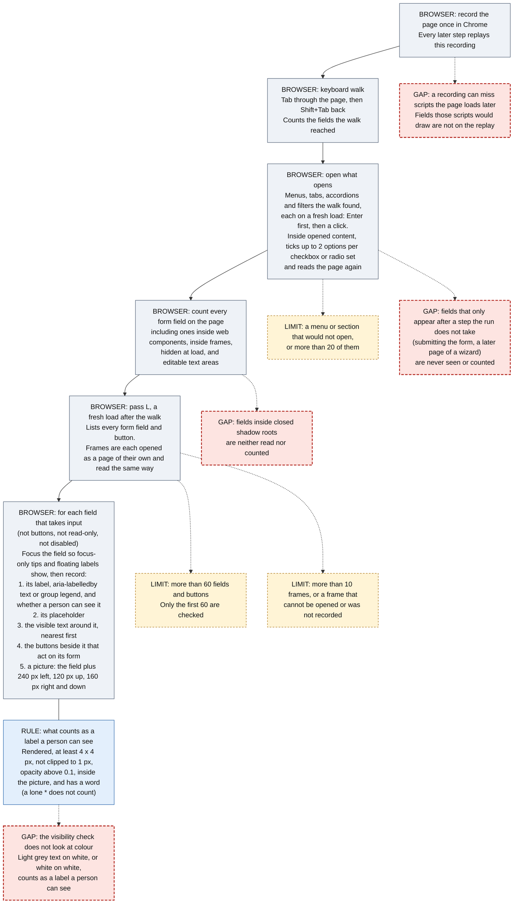
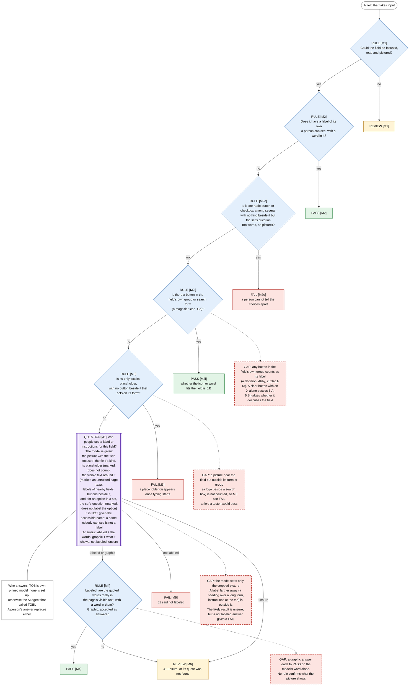
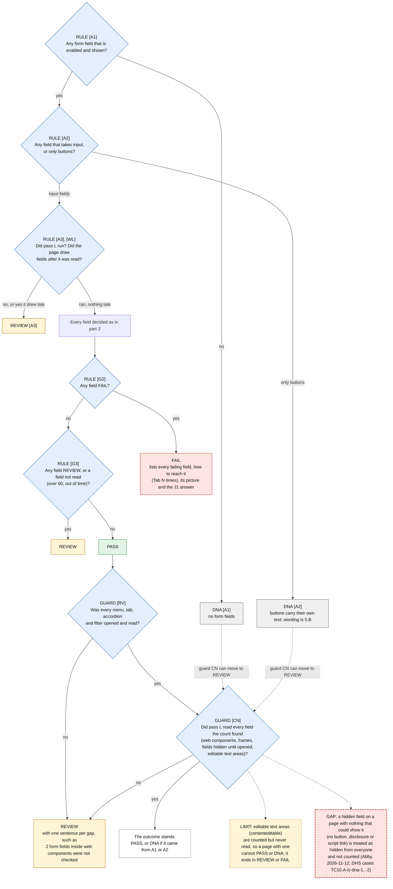

# How TOBI runs Test 5.A (Label provided)

For a Trusted Tester who wants to check TOBI's approach to 5.A without
reading Python. The rules themselves are in
[specs/rules/5a-label-provided.md](../../specs/rules/5a-label-provided.md)
(spec 1.15.0). Row IDs in brackets, such as [M3], point to rows there. The
diagrams follow the rules spec; when they disagree, the spec is right.

TOBI's results are agent-assisted. They are not a certified Trusted Tester
result.

**How to read the diagrams.** Every box starts with a word that says what
kind of step it is. The colours repeat that word, so the diagrams can be read
without them.

| Word | Meaning |
| --- | --- |
| BROWSER | Done in real Chrome, on a recording of the page |
| RULE | A fixed check in TOBI's code. It decides the same way every time |
| QUESTION | An open question that a model answers by looking at a picture. The answer is a fact for a rule, never an outcome |
| PASS, FAIL, DNA, REVIEW | An outcome. REVIEW is NEEDS REVIEW: "This test could not be performed", plus the reason |
| LIMIT | Something TOBI knows it cannot do. The outcome becomes REVIEW, so a person checks it |
| GAP | Something TOBI can miss without saying so. These are the places to check by hand |

## 1. What happens in the browser

TOBI records the page once. Every later step works on that recording, so a
rerun reads the same page. The steps after the recording are shared with
other tests. 5.A reuses pass L, which 5.C also uses.

## 2. Each field

Each field that takes input is checked separately. Each radio button and
each checkbox counts as a field of its own. Rules run top to bottom and the
first one that matches decides. A model is asked only when no rule could
decide.

## 3. The page's outcome

The answers for the separate fields become one 5.A outcome for the page.
Two guards then check whether TOBI read everything it should have. A guard
can only move PASS (and, for one guard, DNA) to REVIEW. It never moves an
outcome toward PASS.

## Gaps and limits in one list

A tester checking TOBI's 5.A result by hand should start with the GAP rows:
each one can produce a wrong PASS or FAIL without a REVIEW to flag it.

| Kind | What | Effect on the result | Where it comes from |
| --- | --- | --- | --- |
| GAP | Fields that appear only after a step the run does not take (submit, the next page of a wizard) | Not seen, not counted: can PASS or DNA a form whose later fields fail | Spec 5.C section 2, "Fields revealed by interaction" |
| GAP | Fields inside closed shadow roots | Not seen, not counted | `_template.md`, "Inside web components and frames" |
| GAP | Visibility ignores colour | A label in white on white, or in very light grey, counts as visible: can PASS | Spec Terms, *visible label* |
| GAP | Scripts the recording missed | Fields they draw are not on the replay | `docs/solutions/recordings-miss-lazy-scripts.md` |
| GAP | Picture crop (240 / 120 / 160 px) | A distant label is outside the picture: unsure (REVIEW) at best, FAIL if the model says not labeled | Spec section 2; `docs/solutions/server-judge.md` |
| GAP | Graphic answer | PASS rests on the model's description of the picture | Spec J1, M4 |
| GAP | Any button in the field's own group is a label | An X clear button alone passes 5.A (5.B judges the wording) | Spec M2i |
| GAP | A picture outside the field's form or group is ignored | A logo-only search box FAILs at M3 | Spec J1 examples; M3 |
| GAP | A hidden field with nothing on the page to show it is not counted | Can DNA | Guard CN |
| LIMIT | More than 60 fields and buttons | REVIEW | Spec 5.C section 2 |
| LIMIT | More than 10 frames, a frame that will not open, a frame not recorded | REVIEW | Guard CN, `frames_missing` |
| LIMIT | A menu or section that would not open, or more than 20 | PASS becomes REVIEW | Guard RV |
| LIMIT | Editable text areas | Never read: a page with one ends in REVIEW (or FAIL from another field) | Guard CN |
| LIMIT | The page draws fields after it was read | REVIEW | Row WL |
| LIMIT | Run out of time | REVIEW | G3 |

## What this diagram does not show

- How 5.A's labels feed 5.B (are they descriptive?) and 5.C (are they in the
  code?). The three tests share pass L.
- The plain-language sentences a user sees. They are in the spec's section 3.
- The exact words of the open question and its rubric. They are in the
  spec's section 4.
