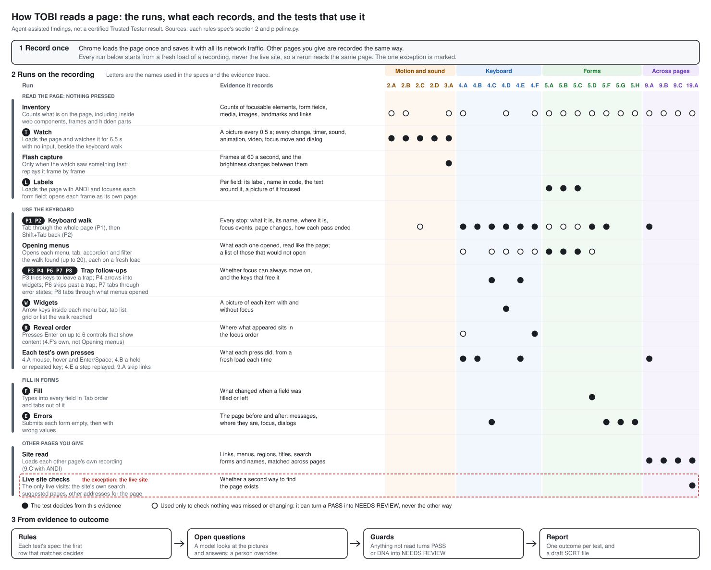

# How TOBI reads a page

One picture of every run TOBI makes on a page, what each one records, and
which Trusted Tester tests use it. The letters (P1, T, L, E and so on) are
the names the rules specs and the evidence trace use.

TOBI's results are agent-assisted. They are not a certified Trusted Tester
result.

**How to read it.** A filled dot means the test decides from that run's
evidence. A ring means the test uses it only to check that nothing was
missed or still changing. A ring can turn a PASS into NEEDS REVIEW, never
the other way. Runs are grouped by what they do to the page, not by the
order they happen in. In time order: record, then the watch beside the
keyboard walk, opening menus, the inventory, and then each test's own runs.

**Two runs that are easy to confuse.** *Opening menus* (`reveal.py`) opens
up to 20 menus, tabs and sections for every test that reads opened content.
*Reveal order* (pass R) is 4.F's own: it presses Enter on up to 6 controls
to see where the new content sits in the focus order.

## The same facts as text

| Run | What it does | Evidence it records | Tests that decide from it | Tests that check against it |
| --- | --- | --- | --- | --- |
| **Read the page: nothing pressed** | | | | |
| Inventory | Counts what is on the page, including inside web components, frames and hidden parts | Counts of focusable elements, form fields, media, images, landmarks and links | – | 2.A, 2.B, 3.A, 4.A, 4.D, 4.F, 5.A, 5.B, 5.C, 5.D, 5.F, 5.G, 5.H, 9.A, 9.B, 9.C, 19.A |
| Watch (T) | Loads the page and watches it for 6.5 s with no input, beside the keyboard walk | A picture every 0.5 s; every change, timer, sound, animation, video, focus move and dialog | 2.A, 2.B, 2.C, 2.D, 3.A | – |
| Flash capture | Only when the watch saw something fast: replays it frame by frame | Frames at 60 a second, and the brightness changes between them | 3.A | – |
| Labels (L) | Loads the page with ANDI and focuses each form field; opens each frame as its own page | Per field: its label, name in code, the text around it, a picture of it focused | 5.A, 5.B, 5.C | – |
| **Use the keyboard** | | | | |
| Keyboard walk (P1 P2) | Tab through the whole page (P1), then Shift+Tab back (P2) | Every stop: what it is, its name, where it is, focus events, page changes, how each pass ended | 4.A, 4.B, 4.C, 4.D, 4.E, 4.F, 5.D, 5.F, 9.A | 2.C, 5.A, 5.B, 5.C |
| Opening menus | Opens each menu, tab, accordion and filter the walk found (up to 20), each on a fresh load | What each one opened, read like the page; a list of those that would not open | 5.A, 5.B, 5.C | 4.A, 4.C, 4.D, 4.E, 4.F, 5.D |
| Trap follow-ups (P3 P4 P6 P7 P8) | P3 tries keys to leave a trap; P4 arrows into widgets; P6 skips past a trap; P7 tabs through error states; P8 tabs through what menus opened | Whether focus can always move on, and the keys that free it | 4.C, 4.E | – |
| Widgets (W) | Arrow keys inside each menu bar, tab list, grid or list the walk reached | A picture of each item with and without focus | 4.D | – |
| Reveal order (R) | Presses Enter on up to 6 controls that show content (4.F's own, not Opening menus) | Where what appeared sits in the focus order | 4.F | 4.A |
| Each test's own presses | 4.A mouse, hover and Enter/Space; 4.B a held or repeated key; 4.E a step replayed; 9.A skip links | What each press did, from a fresh load each time | 4.A, 4.B, 4.E, 9.A | – |
| **Fill in forms** | | | | |
| Fill (F) | Types into every field in Tab order and tabs out of it | What changed when a field was filled or left | 5.D | – |
| Errors (E) | Submits each form empty, then with wrong values | The page before and after: messages, where they are, focus, dialogs | 4.C, 5.F, 5.G, 5.H | – |
| **Other pages you give** | | | | |
| Site read | Loads each other page's own recording (9.C with ANDI) | Links, menus, regions, titles, search forms and names, matched across pages | 9.A, 9.B, 9.C, 19.A | – |
| Live site checks | The only live visits: the site's own search, suggested pages, other addresses for the page | Whether a second way to find the page exists | 19.A | – |

## Keeping it current

The diagram and the table come from one list in
`scripts/draw_runs_diagram.py`, taken from each rules spec's section 2
("Evidence to collect") and `pipeline.py`. After a run is added or changed,
update that list, run `uv run python scripts/draw_runs_diagram.py`, and paste
the table it prints over the one above.
