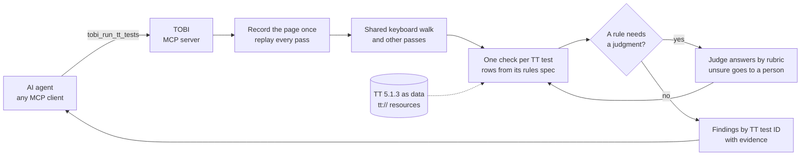

# Deck outline

GSA MCP and AI Agent Hackathon

> **Draft.** One section per slide, in the order of GSA's sample deck
> (challenge, solution, design and key decisions, demo, evaluation,
> security, lessons). "On the slide" is the text to show; "Notes" is what
> to say. Figures come from [evaluation.md](evaluation.md); update both
> together. **[FILL: …]** marks a final figure from the scored run;
> **[PENDING]** marks work not done yet.

---

## 1. Title

**On the slide**

- Section 508 TOBI: Tester-Oriented Browser Inspector
- An MCP server that follows the DHS Trusted Tester process in a real browser
- Agent-assisted results, not certified Trusted Tester results

**Notes:** Built by a certified Trusted Tester with Claude Code, from GSA's template. It reads public government web pages and writes nothing to them.

---

## 2. The challenge: the checks no scanner can run, and too few people to run them

**On the slide**

- 60% of federal reporting entities have no or only some staff trained in Section 508 web testing (GSA, FY 2024)
- Testing is the weakest part of federal Section 508 programs: 2.00 of 5 (GSA, FY 2025)
- A certified Trusted Tester needs about 70 hours of training plus a multi-hour exam (ONRR)
- Scanners miss most barriers and every keyboard trap: of the Trusted Tester test conditions we mapped, they reliably cover 3, partly cover 21 and miss 36

**Notes:**

- Sources are in [evaluation.md](evaluation.md), section 1.
- A keyboard trap locks out anyone who cannot use a mouse, including many blind users and people with motor disabilities.
- The Trusted Tester process is precise: it says which keys to press and what counts as a failure. That precision makes it a candidate for an agent, as long as the agent never claims to be a certified tester.

---

## 3. The solution: an MCP server that follows the procedure

**On the slide**

- Opens the page in real Chrome and presses real keys
- Follows TT 5.1.3 step by step, from rules kept in version control
- Reports each finding by TT test ID, in plain language, with evidence
- Says "needs review" instead of guessing
- 22 tests so far: keyboard, forms, moving and flashing content, and consistency across a site's pages
- Handles the clear-cut cases, so certified testers can spend their time on the hard ones

**Notes:**

- Any MCP client is the front end: a developer asks in plain words, in the tool they already use.
- The rules decide every outcome. A model only answers narrow questions a rule asks, such as "does the page say how to leave this section?", and where it can, the tool checks the answer by pressing the key.

---

## 4. Server design overview

**On the slide:** diagram

**Notes:**

- **Five tools, each a whole task:** run tests on a page, wait for a long run, answer open questions, explain a result, read and compare report files. Inputs are validated Pydantic models; the list of implemented tests in the tool description comes from the code's registry.
- **Resources:** `tt://5.1.3/...` serves the Trusted Tester text; `run://` serves a run's evidence while it is kept.
- **One module per TT test,** one rules spec per module, one tool per file. Adding a test changes no tool.
- Python, FastMCP, Pydantic and Playwright, from the GSA template.

---

## 5. Key decision: the Trusted Tester PDF is the authority

**On the slide**

- One rules spec per TT test, citing the PDF's page and step for every rule
- Outcome logic lives only in spec rows; every report records the spec version
- The whole PDF is stored as data and checked word for word against the PDF

**Notes:** When the PDF disagrees with itself we record it and do not resolve it silently. A spec step must match something the PDF asks a human tester to do: the aim is consistency with a careful tester, not exceeding one.

---

## 6. Key decision: a false PASS is the worst error

**On the slide**

- When a rule cannot decide: NEEDS REVIEW, never PASS
- An opinion becomes PASS only when a key press confirms it, or the question is one a tester settles by looking
- A test the tool cannot perform says so, by name

**Notes:** A false PASS hides a barrier from the people it blocks. A false FAIL costs a developer time. The scoring weights say the same: a false PASS counts three times any other error.

---

## 7. Key decision: record once, replay every pass

**On the slide**

- The page is recorded once; every key press and form entry goes to the recording, never the live site
- Same recording, same result: variation can only come from judgment, where it can be measured
- ANDI, jQuery and the browser automation are pinned and recorded in every report
- Focus is read through Chrome DevTools, so page scripts cannot fake it

**Notes:** One keyboard walk feeds every keyboard test, and each new test reuses what earlier ones collected. A recording can lack code a page loads only when it is used; the tool keeps such scripts and holds a pass back when one is missing (found on a real NASA page in round 2).

---

## 8. Key decision: the server judges, a person reviews, the agent explains

**On the slide**

- Calling agents skipped the judgment work or guessed at it, whatever the wording
- So the judge moved into the server: one pinned model and prompt, recorded in every report
- "Unsure" goes to a person, and a person's answer overrides the model's
- The calling agent does what the server cannot: explain results in the user's own project and help fix them

**Notes:** The agency controls the judge, a person has the last word, and any MCP agent is the front end. The server judge is built and off by default; it is switched on one question type at a time as checks against a certified tester's answers show it is sound. **[FILL: question types switched on at submission.]**

---

## 9. Demo

**On the slide:** live or recorded run

**Script [PENDING: rehearse; record a fallback video]:**

1. In an MCP client, ask in plain words to check a page for keyboard problems (a W3C test page served locally, or a .gov page).
2. Show the progress line, then a finding: FAIL, which elements trap focus, steps to reproduce, the screenshot.
3. Show an open question, the answer it got, and what "needs review" looks like.
4. Ask for an explanation of the result: what failed and how to fix it.
5. Point at the disclaimer in the output.

---

## 10. Evaluation setup

**On the slide**

- Answer key from DHS: Trusted Tester verdicts on W3C's test pages, exact match, no LLM judge
- Real .gov pages labeled blind by a certified Trusted Tester; the tool's results locked before the answers are revealed
- A harder baseline than "no tool": the same model with a general browser tool
- Rule-decided and judge-decided results scored apart

**Notes:**

- We did not write our own answer key, because that would measure agreement with ourselves.
- **[FILL: cases per TT test, and DHS's PASS / FAIL / DNA split.]**
- Two rounds on real pages so far (19 pages, two NASA sites). Both are development evidence: the sites were then used to fix the tool.
- After any change to a question, a fresh agent answers it from the tool's output alone.

---

## 11. Evaluation results

**On the slide**

- Published answer keys: agreed on **[FILL]** of **[FILL]** cases; **[FILL]** false PASS; **[FILL]** false FAIL; **[FILL]** left as "needs review"
- Round 1, real pages: TOBI 0 false PASSes; the same model with a general browser tool 16-20, and it reported no failure anywhere
- Round 2: every false PASS came from a rule, none from a judge's answer; the server judge was repeatable but wrong toward FAIL on one question
- Each round changed the tool: **[FILL: the check against round 2 after the fixes]**

**Notes:**

- Round 1 taught us agents leave judgment work undone, so results now end with the work left, pictures come attached, and long runs outlive a client's timeout.
- Round 2 taught us a recording can hide a failure, that a person opens every menu and the tool had not, and that the judge belongs in the server.
- **[FILL: the main disagreements in the scored run and whether any is a false PASS.]**
- Unless each test has about 60 true failures, say "promising, not proven".

---

## 12. Security considerations

**On the slide**

- Public .gov and .mil pages only, checked on every redirect; no logins, no credentials
- Every browser connection is checked when it connects: names that point inside (private, loopback, cloud metadata) are refused, and DNS rebinding cannot get past the check
- Page content is untrusted: it never chooses a URL, a tool or an outcome, with four narrow, approved exceptions
- A test page tells "automated testers" to report PASS; the tool must still find both traps **[FILL: result]**
- Evidence is kept 24 hours, then deleted; results go to the user's own repository
- No secrets in errors or logs: query strings, headers and page text are redacted
- Hosted only behind NASA sign-in; each person sees only their own runs; every call is audited **[PENDING: end-to-end sign-in on VAST]**

**Notes:**

- The template's unauthenticated HTTP port on all interfaces is gone: stdio by default, HTTP only on loopback with Host and Origin checks unless sign-in is on.
- The four exceptions, each capped: one site search and up to five site-map, home or breadcrumb pages for the "multiple ways" test, on the same host; one key combination that the page names as a way to stop moving content, pressed on a replay; and recording the scripts a page's own scripts name.
- Page text reaches the server's judge only inside a block marked untrusted, escaped so the text cannot close it.
- The server's judge reads a picture only through the guarded evidence reader, and only one the question names as a whole value; page text cannot point it at another file or another person's run.
- Every result says "not a certified Trusted Tester result", and the report cannot be marked certified.

---

## 13. Lessons learned and recommendations

**On the slide**

1. Look for an official answer key before writing your own
2. Name your worst error and design around it
3. Keep rules and model judgment apart, and score them apart
4. Measure what the agent does, not what the tool description asks
5. Write down what you verified and what you assumed

**Notes:**

- **Lesson 1:** DHS's published verdicts gave us certified-tester ground truth on day one.
- **Lesson 3:** splitting the score showed the rules, not the model, caused every false PASS in round 2.
- **Lesson 4:** more wording moved the shortcut; putting the next step in the data, and then moving the judge into the server, removed it.
- **Lesson 5:** this repository keeps a `docs/solutions/` folder of hard-won lessons, such as "pages can fake focus" and "a recording can lack code the page loads when used".

---

## 14. What's next

**On the slide**

- Fewer false FAILs and fewer "unsure" answers: the rule and question fixes round 2 pointed to
- Fields inside frames, and the keyboard walk through everything a page can open
- A person's answer from TOBI's own signed-in page, kept so the same question is answered once per site
- A third round on a site not used before, with a second certified tester if one is available
- More of the 61 tests: images, contrast, headings, resize, where scanners and people disagree most
- Drafts a certified tester can finish in DHS's own report format

**Notes:** Each test's status on real pages is in the repository's README. **[FILL: tests and spec versions at submission.]**
