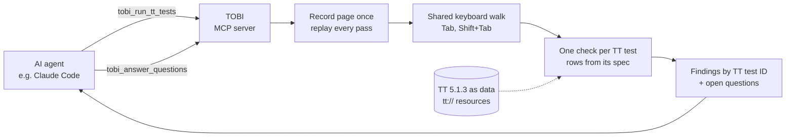

# Deck outline

GSA MCP and AI Agent Hackathon

> **Draft.** One section per slide, following GSA's sample deck. "On the
> slide" is the text to show; "Notes" is what to say. Figures come from
> [evaluation.md](evaluation.md); update both together. **[FILL: …]** marks a
> final figure; **[PENDING]** marks work not done yet.

---

## 1. Title

**On the slide**

- Section 508 TOBI: Tester-Oriented Browser Inspector
- Agent-assisted keyboard testing that follows the DHS Trusted Tester process
- Not a certified Trusted Tester result

**Notes:** Built by a certified Trusted Tester with Claude Code. Open source at github.com/abbybowman/tobi508.

---

## 2. The challenge: the checks no scanner can run, and too few people to run them

**On the slide**

- 60% of federal reporting entities have no or only some staff trained in Section 508 web testing (GSA, FY 2024)
- Testing is the weakest part of federal Section 508 programs: 2.00 of 5 (GSA, FY 2025)
- Becoming a certified Trusted Tester takes about 70 hours of training plus a multi-hour exam (ONRR); DHS lowered the pass mark from 90% to 85% in 2024 to make it more attainable
- Scanners miss many barriers, and every keyboard trap: axe-core has no rule for keyboard traps, focus visibility, focus changes or focus order
- Of 60 active Trusted Tester test conditions, scanners reliably cover 3 and partly cover 21; 36 get no coverage (our map, axe-core 4.14 and pa11y 10)

**Notes:**

- Sources are in [evaluation.md](evaluation.md), section 1.
- A keyboard trap locks out anyone who can't use a mouse, including many blind users and people with motor disabilities.
- The Trusted Tester process is precise: it says which keys to press and what counts as a failure. That precision makes it a candidate for an agent, as long as the agent never claims to be a certified tester.
- **[PENDING]** DHS doesn't publish how many certified testers there are; request the figures listed in evaluation.md.

---

## 3. The solution: an MCP server that follows the procedure

**On the slide**

- Opens the page in real Chrome and presses real keys
- Follows TT 5.1.3 step by step, from rules written in version control
- Reports each finding by TT test ID, in plain language, with evidence
- Asks the agent narrow questions only where a rule needs judgment; a person can override
- Says "needs review" instead of guessing
- Handles the clear-cut cases, so certified testers can focus on edge cases and low-confidence calls

**Notes:**

- The agent never decides an outcome on its own.
- The rules decide outcomes. The agent answers narrow factual questions, such as "does the page document a key that escapes this section?", and the tool checks the answer by pressing that key.

---

## 4. Server design overview

**On the slide:** diagram

**Notes:**

- **Two broad tools.** `tobi_run_tt_tests` takes a URL and test IDs. `tobi_answer_questions` takes the agent's answers to open questions.
- **Resources.** `tt://5.1.3/...` serves the TT text; `run://` serves a run's evidence while it is kept.
- **Prompt.** `explain` covers a test or a result in plain language.
- **Python stack.** FastMCP, Pydantic and Playwright, from the GSA template.

---

## 5. Key decision: the TT PDF is the authority

**On the slide**

- One rules spec per TT test, citing the PDF's page and step for every rule
- Outcome logic lives only in spec rows; each report records the spec version
- The whole PDF is stored as data (63 conditions), checked word for word against the PDF

**Notes:** When the PDF disagrees with itself, we record it rather than resolve it silently. Examples: it says 63 conditions on one page and lists 62 in an appendix, and 6.B was removed but still appears in the quick reference.

---

## 6. Key decision: collect once, evaluate many

**On the slide**

- One keyboard walk per page feeds every Test 4 check, and 5.D On input
- Each check declares the extra evidence it needs
- Time budget: under 60 s per page for Test 4, hard limit 10 min per run (+45 s when content keeps changing by itself, like a ticker); a call returns within 45 s and a longer run goes on in the server, at most two at once
- No time limit by default since 2026-11-07 (a run stops at 30 min; each still-running result gives a progress line to relay); a caller can ask for the 10-minute limit, and a page too large for it is refused early
- Replays reuse what the walk saw: realistic agency page 151 s → 97 s, same outcomes
- Checks reuse each other's replays (4.A reads 4.D's arrow presses and 4.F's Enter presses): with 5.F and 5.G added, both realistic pages still fit with all eleven tests (110.2 s and 97.1 s)

**Notes:**

- The PDF chains these tests itself: 4.D continues from 4.C, 4.E from 4.D.
- Each new test should cost less to add than the last.

---

## 7. Key decision: a false PASS is the worst error

**On the slide**

- When a rule can't decide → NEEDS REVIEW, never PASS
- An agent's opinion becomes PASS only when a key press confirms it
- Proportionate to the PDF: do what a careful tester does, not more

**Notes:** Trimming spec steps that went past what the PDF asks of a human cut test time sharply. **[FILL: figures, if still representative.]**

---

## 8. Key decision: repeatable by construction

**On the slide**

- Pages recorded once and replayed; test pages stored with hashes; pages with cross-site iframes replay in full Chromium
- ANDI, jQuery and browser automation pinned and recorded in every report
- Focus read through Chrome DevTools, so page scripts can't fake it

**Notes:** Variation between runs should come only from the agent's judgment, so it can be traced and measured.

---

## 9. Demo

**On the slide:** live or recorded run

**Script [PENDING: rehearse; record a fallback video]:**

1. In Claude Code, ask in plain words to check a page for keyboard traps (an ACT trap case served locally, or a .gov page).
2. Show the progress messages, then the finding: FAIL, which elements trap focus, steps to reproduce, screenshot.
3. Show an open question and the agent's answer, then how a person overrides it.
4. Run the `explain` prompt on the result: what failed and how to fix it.
5. Point at the disclaimer in the output.

---

## 10. Evaluation setup

**On the slide**

- Answer key from DHS: Trusted Tester verdicts on W3C's ACT test pages
- **[FILL: cases per TT test, and DHS's PASS / FAIL / DNA split]**
- Exact match on outcomes; no LLM judge
- Development pages reported apart from held-out real .gov pages

**Notes:**

- We didn't write our own answer key, because that would measure agreement with ourselves.
- **[FILL: whether open questions were answered by a script or by Claude in the scored run.]**
- **[PENDING]** Held-out real .gov pages, labeled blind by a certified tester in SCRT and scored by commit and reveal: page list and answer-file hashes committed when a round starts, the tool's results locked before the answers are added (`evals/judging.py`).
- **[PENDING]** Agent-level evaluation against a browser-agent baseline (same model with Playwright MCP): blind-labeled real .gov pages and seeded faults (DHS training-course pages if allowed), three model families through NASA's Ask Sage, outcomes scored in code and wording by a judge from another family. Round 1 first: 9 pages, one run per arm (Sonnet 5.5 through the Claude Code CLI), the same WCAG 2.0 criteria prompt, tested pages frozen and the rest of the site live, scored per TT test and per criterion.
- Fixes after round 1, before round 2: alike open questions asked once (5.D 1.1.0: a page's 96 filter-checkbox questions became 4); a site search is Does Not Apply for 5.F and 5.G (1.2.0); header menu buttons are not form controls (5.A, 5.B 1.2.0). Calls return within 45 s while longer runs go on in the server. Each result says what to do next; a page with too many fields is tested without 5.D; 19.A asks the agent to add pages; 4.D leaves an element that moved while pictured for review (1.2.0). 4.F ignores a site overlay that a menu did not open, and reads card grids and checkbox labels as people see them (1.2.0). The scorer scores split calls test by test and says why each result needs review. Results attach the pictures their questions need and stay under client limits; a set of filter boxes is one question (5.C 1.2.0); questions settled by reading carry no pictures (2.D 1.1.0, 5.F 1.3.0), and groups whose headings screen readers never hear fail (1.3.0); one call lists the work left across a session's runs; a keyboard trap must happen on two loads before the walk stops for it, and one seen on one load is left for a person (4.C 1.9.0); an error check read before the page finished reacting is left for review (5.F 1.3.1, 5.G 1.2.1); the focus question counts the changed pixels on, touching and away from the element (4.D 1.3.0); a required "*" drawn by CSS counts as shown text (5.C 1.4.0); a dialog or change over most of the window is never "content only" (4.E, 5.D 1.2.0); the focus order picture is cut to the part in question (4.F 1.3.0); moving content below the first screen gets its own pictures (2.B 1.1.0). Round 2 adds a third arm, the server judge (Agent C): TOBI's questions answered on the server by a pinned model and prompt, three repeats, scored beside A and B, with judge-decided cells reported apart from rule-decided ones. Round 2, paused before scoring: a result that would pass the client's size limit shows fewer questions and cuts long page text to the passages its question quotes, and replays of large recordings wait up to 120 s. Built, off by default (2026-11-09): the server's own judge (ApiJudge): one request per group of related questions, page data in an untrusted block, answers limited to each question's choices and applied through the same checks, unsure to a person, a client answer to a server answer refused, model and prompt recorded; nothing is on until the gate passes (not run yet).

---

## 11. Evaluation results

**On the slide**

- Agreed with DHS on **[FILL]** of **[FILL]** pages, per TT test
- Caught **[FILL]** of **[FILL]** failures: **[FILL]** false PASS
- **[FILL]** false FAIL; **[FILL]** left as "needs review"
- Held-out real pages: **[FILL]**

**Notes:**

- **[FILL: the main disagreements and whether any is a false PASS.]**
- Unless each test has about 60 true failures, say "promising, not proven."

---

## 12. Security considerations

**On the slide**

- Public .gov/.mil pages only, checked on every redirect; no logins, no credentials
- Every browser connection is checked at connect time: names that point inside (private, loopback, cloud metadata) are refused, and DNS rebinding can't get past the check (an optional upstream proxy for cloud containers keeps the checks, with the upstream resolving the name again)
- Page content is untrusted: never shown to the agent as instructions; outcomes come only from rules; page scripts cannot fake where focus is, even where a skip link lands
- Other pages for the multi-page tests come only from the user, on the same allowed host; links on a page are never followed; two exceptions for 19.A: one GET site search on the same host, and up to 5 site map, home or breadcrumb links on the same host, tested in a follow-up run, each recorded; if a page is too slow to record, the other tests still run and the multi-page tests say why they could not
- A test page tells "automated testers" to report PASS; the tool must still find both traps **[FILL: result]**
- Evidence kept 24 h, then deleted; results go to the user's repository
- No secrets in errors or logs: query strings, headers and page text are redacted
- Every result says "not a certified Trusted Tester result"
- Hosted only behind NASA sign-in (Launchpad through VAST's Keycloak, NAMS enforced); each person sees only their own runs; every call is audited with who and what **[PENDING: end-to-end sign-in on VAST]**

**Notes:**

- The template's default of opening an unauthenticated HTTP port on all interfaces is gone: stdio by default, HTTP only on loopback with Host and Origin checks unless sign-in is on. With sign-in, every MCP request needs a NASA token, an optional VAMS or NAMS group gate applies, runs are private to their maker, and each call writes an audit line (no answers or page text).
- Errors and logs carry no query strings, headers, stack traces or page text; a test seeds secrets and checks they don't leak.

---

## 13. Lessons learned and recommendations

**On the slide**

1. Look for an official answer key before writing your own
2. Name your worst error and design around it
3. Keep rules and model judgment apart, and score them separately
4. Write down what you verified and what you assumed

**Notes:**

- **Lesson 1:** DHS's published verdicts gave us certified-tester ground truth on day one.
- **Lesson 3:** Exact-match scoring works whenever outputs are categories.
- **Lesson 4:** This repo keeps a `docs/solutions/` folder of hard-won lessons, such as "pages can fake focus" and "cookie banners leak state between probes."

---

## 14. What's next

**On the slide**

- **[FILL: remaining Test 4 work at submission]**
- Real-site holdout with a second certified tester
- A published side-by-side on real .gov pages: certified testers, TOBI and five scanners
- Export drafts to DHS's SCRT format so a certified tester can review and finish them
- Test 2 (2.A Audio control, 2.B Blinking and moving, 2.C Auto-updating, 2.D Change notification; 1.0.0): a second browser watches the page with autoplay allowed, then tries the controls near changing content with the keyboard (W3C ACT efbfc7 11/11 and 80f0bf, 4c31df, aaa1bf 14/14 as expected; judge eval 18/18, no false PASS)
- 3.A Flashing (1.0.0): the page's own clock stepped frame by frame and media decoded, because screenshots alias a strobe; flashing found is NOT TESTED as the TT says, with the tool's experimental WCAG 2.3.1 assessment as a note for DHS or W3C to judge (16 custom pages; no answer key exists)
- Built after Test 4: 5.D On input (forms that change context when filled in), 5.F Error identification and 5.G Error suggestion (forms whose errors are not named, explained, announced or fixable), 5.A Label provided, 5.B Label descriptive and 5.C Programmatic label (labels people can see, and what ANDI says screen readers announce); 5.H Error prevention (payments and other consequential forms can be reviewed, undone or checked), which completes Test 5
- Multi-page 9.A Bypass, 9.B Consistent navigation, 9.C Consistent identification and 19.A Multiple ways: the page compared with other pages of the same site the user names (judge eval 6/6, no false PASS, with the evidence in hand; real agents rarely opened screenshots, which a fix addresses; 9.C spec 1.1.1 says when names alone show two controls do different things)
- Then: more form tests, headings, reading order — where scanners fall short
